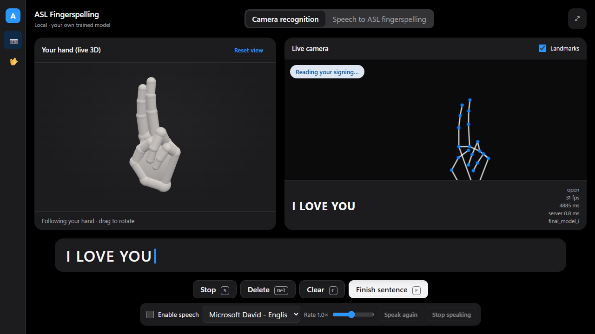
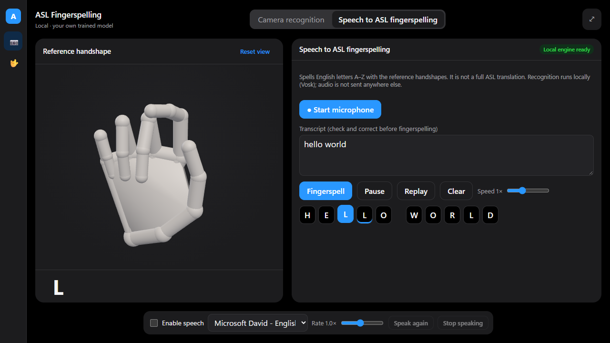
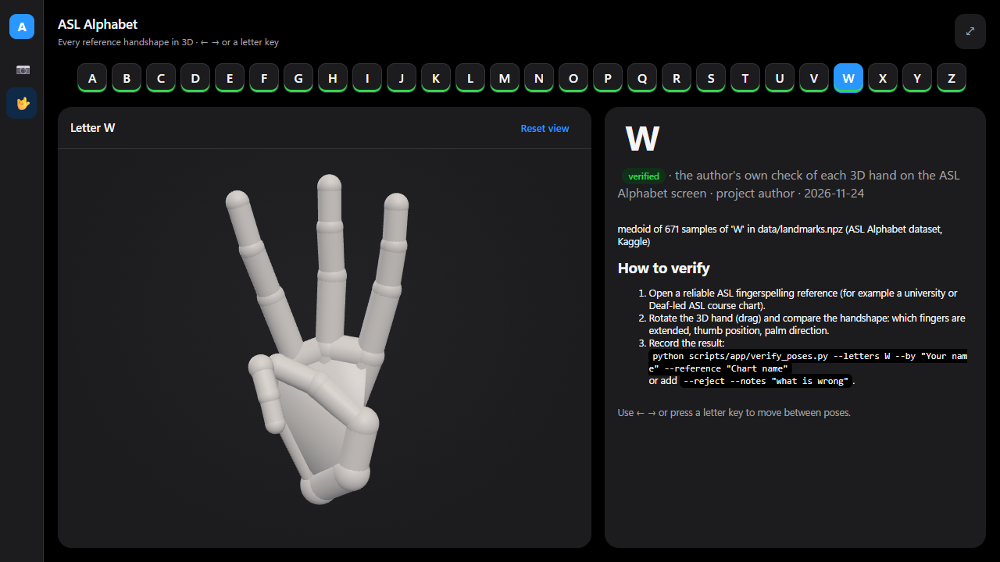

# ASL Fingerspelling Recognition

Fingerspell American Sign Language (ASL) letters in front of your webcam, and this app writes the
words on screen as you sign. It can also do the opposite: say or type a sentence and a 3D hand
fingerspells it for you.

Everything runs on your own computer in the browser. No video leaves your machine.



## What you can do

| Screen | What it does |
|---|---|
| **Camera recognition** | Fingerspell A–Z at normal speed; the words appear live, a 3D hand copies your hand, and the finished sentence can be read aloud. |
| **Speech to ASL fingerspelling** | Speak (or type) English; a 3D hand fingerspells it letter by letter. |
| **ASL Alphabet** | Look at the reference handshape of every letter in 3D and turn it with the mouse. |

<p>
  
  
</p>

The recognition is our own model, `final_model_i`: a small neural network (a temporal convolution
network trained with CTC loss) that reads the hand's movement over time and outputs letters and spaces.
It was trained on Google's FSboard fingerspelling videos and then on the author's own signing.
A word decoder with an English word list then fixes small spelling slips.

## Quick start (Windows)

You need:

* **Windows 10 or 11** with a **webcam**, and **Chrome** or **Edge**
* **Python 3.11** ([python.org](https://www.python.org/downloads/release/python-3119/); TensorFlow does not support 3.13 or newer yet)
* **Node.js 18 or newer** ([nodejs.org](https://nodejs.org/), needed once to build the web page)
* **Git** ([git-scm.com](https://git-scm.com/))

Open **PowerShell** and run these lines one by one:

```powershell
git clone https://github.com/zonghanlee02-ops/asl-fingerspelling.git
cd asl-fingerspelling
py -3.11 -m venv venv
venv\Scripts\python.exe -m pip install -r requirements.txt
npm --prefix frontend install
npm --prefix frontend run build
```

The `pip install` step downloads TensorFlow and MediaPipe (several hundred MB) and takes a few minutes.

Optional, for the speech screen (offline speech-to-text, about 40 MB):

```powershell
venv\Scripts\python.exe scripts\app\download_vosk_model.py
```

### Start the app

```powershell
.\start.bat
```

(In PowerShell the `.\` is needed; you can also double-click `start.bat` in File Explorer.)
The browser opens **http://127.0.0.1:8000**. Allow camera access when the browser asks.
The first start takes 10–20 seconds while TensorFlow loads. If the page says it cannot reach the
backend, wait a moment: it connects by itself as soon as the server is ready.

To stop the app, press `Ctrl+C` in the window where the server runs (or close that window).

## How to use

### Camera recognition

1. The camera turns on by itself. Put one hand in view, about an arm's length from the camera.
2. Press **Start** (or the **S** key) and fingerspell at your normal speed.
3. Leave a short pause between words; the model writes the space.
4. The words appear under the video: the confirmed words, and the current guess, which can still change.
5. Press **Finish sentence** (**F**) when the sentence is done. It is stored and, with **Enable speech**
   ticked, read aloud once.

| Key | Action |
|---|---|
| **S** | Start / stop reading |
| **F** | Finish the sentence |
| **C** | Clear the sentence being read |
| **Delete** | Remove the last word of the last finished sentence |

Tips for good results: good light on your hand, a plain background, the whole hand inside the picture,
and only one hand in view.

### Speech to ASL fingerspelling

1. Switch to **Speech to ASL fingerspelling** at the top.
2. Press **Start microphone**, speak, then **Stop**, or simply type in the box.
3. Correct the text if needed and press **Fingerspell**. Use Pause, Replay and Speed to follow along.
   Only the letters A–Z are signed.

### ASL Alphabet

Click the hand icon on the left. Pick a letter (or press its key) and drag the hand to turn it.
J and Z are signed with a movement, which is described next to the hand.

## Troubleshooting

| Problem | What to do |
|---|---|
| `start.bat` "is not recognized" | In PowerShell type `.\start.bat`, not `start.bat`. |
| "Virtual environment not found" | Run the Quick start steps first (the `venv` folder is missing). |
| "Cannot reach the local backend" | The server is not running or still starting. Start it with `.\start.bat`; the page reconnects by itself. |
| Camera is busy or does not start | Close other apps that use the camera (Zoom, Teams, …) and press **Turn camera on**. |
| No words appear | Press **Start** first. Check that the blue hand points show on your hand in the camera picture. |
| `pip install` fails on TensorFlow | Check `py -3.11 --version`; the project needs Python 3.11. |
| The page looks old after an update | Rebuild with `npm --prefix frontend run build`, then reload with `Ctrl+F5`. |

## Results

Measured on recordings of words the model never saw in training (the author's own signing,
Windows laptop with an Intel Core i5-8265U, CPU only):

| Test | Result |
|---|---|
| 80 test words, exact word, after the word decoder | 73 of 80 (98.3% of letters right) |
| The same signed 1.5× / 2× faster | 76 / 77 of 80 |
| "I LOVE YOU" phrases never trained on | 12 of 13 |
| Time per frame on the server | median 0.3 ms (model), 18–26 ms with MediaPipe, so about 25–30 frames per second |

All details: [docs/SEQUENCE_MODEL.md](docs/SEQUENCE_MODEL.md).

## Limitations

* **Trained on one signer.** Accuracy for other people, cameras and lighting has not been measured.
* **Letters A–Z and spaces only.** No digits and no whole-word signs.
* **Spaces need a short pause** between words.
* **Speech-to-text is English only** and needs the optional Vosk download.
* **Reference hand poses** come from data (MediaPipe hand points). The author checked all 26 on the
  ASL Alphabet screen; it is not a review by a Deaf signer or an ASL teacher.

## How it works

```
webcam ─► browser ─(JPEG frames, 30 per second)─► local Python server
                                                   │
                         MediaPipe: 21 hand points per frame
                                                   │
                         final_model_i (TCN + CTC): letters and spaces over time
                                                   │
                         word decoder: 30,000 English words + 100,000 word pairs
                                                   │
browser ◄────────────────(words, hand points)──────┘  ─► captions, 3D hand, speech
```

More: [docs/ARCHITECTURE.md](docs/ARCHITECTURE.md).

## Project structure

```
backend/          Python server (FastAPI) and the model code
  server/           python -m backend.server: the web page, /ws/live (camera), /ws/speech
  asl/              hand points, MediaPipe tracker, speech-to-text
  asl/seq/          the sequence model: TCN + CTC, live reading, word decoder
  models/           final_model_i (the trained model the app uses)
frontend/         the web page (React + Vite + Three.js)
notebooks/        Google Colab notebooks that train the model
scripts/          recording, packing and checking tools, 3D pose tools
tests/            Python tests
docs/             detailed documentation
data/             English word lists and the word lists used for recording
```

## Train your own model

Training runs in Google Colab (free GPU), not on the laptop:

1. Record your own takes: `venv\Scripts\python.exe scripts\sequence_model\seq_record_word.py`
2. Pack them for Colab: `venv\Scripts\python.exe scripts\sequence_model\seq_pack_my_recordings.py`
3. Open `notebooks/fsboard_tcn_ctc_colab.ipynb` in Colab and follow its steps.

Step by step: [docs/SEQUENCE_MODEL.md](docs/SEQUENCE_MODEL.md) and
[docs/TRAINING_AND_EVALUATION.md](docs/TRAINING_AND_EVALUATION.md).
Your recordings stay in `backend/storage/`, which git ignores.

## Tests

```powershell
venv\Scripts\python.exe -m pip install -r requirements-dev.txt
venv\Scripts\python.exe -m pytest
npm --prefix frontend test
```

Tests that need recordings or models you do not have are skipped automatically.

## More documentation

[Architecture](docs/ARCHITECTURE.md) · [Training & evaluation](docs/TRAINING_AND_EVALUATION.md) ·
[Sequence model](docs/SEQUENCE_MODEL.md) · [Data & privacy](docs/DATA_AND_PRIVACY.md) ·
[Roadmap](docs/ROADMAP.md) · [Project documentation](docs/PROJECT_DOCUMENTATION.md)

## Credits

* [MediaPipe Hands](https://ai.google.dev/edge/mediapipe/solutions/vision/hand_landmarker) (Google): hand points from the camera
* [FSboard](https://www.kaggle.com/datasets/googleai/fsboard) (Google): fingerspelling videos used to train the model
* [ASL Alphabet dataset](https://www.kaggle.com/datasets/grassknoted/asl-alphabet) (Kaggle): source of most reference hand poses
* Peter Norvig's [English word counts](https://norvig.com/ngrams/) (`count_1w.txt`, `count_2w.txt`): the word lists in `data/`
* [Vosk](https://alphacephei.com/vosk/): offline speech-to-text
* [Three.js](https://threejs.org/), [React](https://react.dev/), [Vite](https://vite.dev/), [FastAPI](https://fastapi.tiangolo.com/), [TensorFlow](https://www.tensorflow.org/)

## Licence

The code is released under the [MIT licence](LICENSE). The datasets and word counts listed above
keep their own licences.
