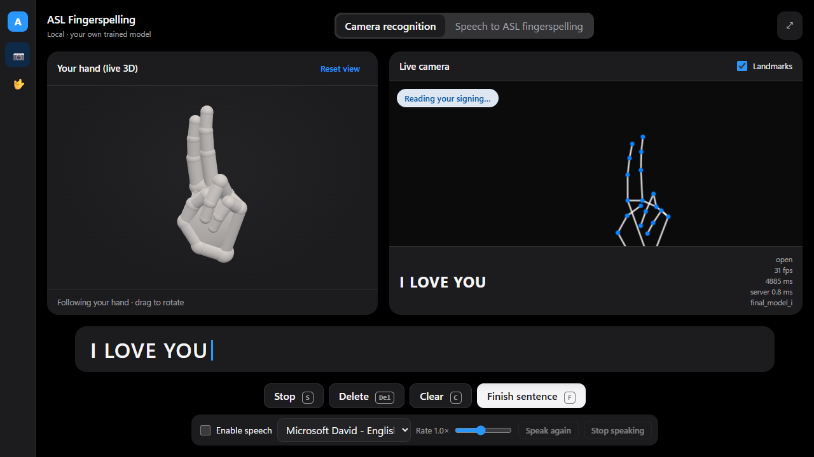
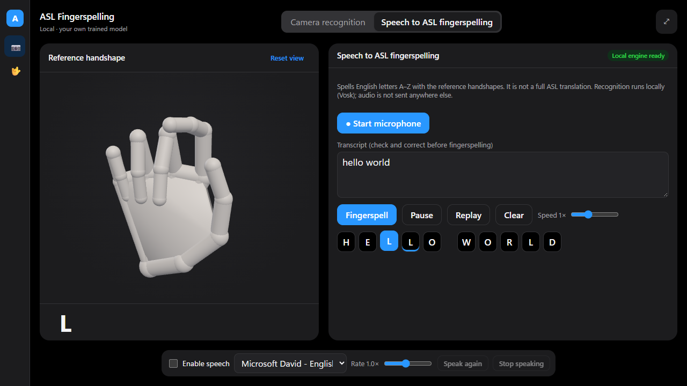

# ASL Fingerspelling Recognition

**Reading American Sign Language fingerspelling from a webcam with our own trained models**

Project documentation, from the start of the project (28 October 2026) to the current state (22 November 2026)

Author: *[your name]*

---

## Contents

1. [Introduction](#10-introduction)
2. [Progress record](#20-progress-record)
3. [Environment set up](#30-environment-set-up)
4. [How the models were built](#40-how-the-models-were-built)
5. [Results](#50-results)
6. [Problems we met and how we solved them](#60-problems-we-met-and-how-we-solved-them)
7. [Installation](#70-installation)
8. [Execution / running](#80-execution--running)
9. [Limitations and next steps](#90-limitations-and-next-steps)
10. [Conclusion](#100-conclusion)
11. [References](#110-references)

---

## 1.0 Introduction

Fingerspelling is the part of American Sign Language (ASL) where a word is spelled letter by letter with
handshapes, one for each letter of the alphabet. It is used for names, places and words that have no sign of
their own. A person who does not know ASL cannot read it, and a fluent signer spells quickly: one letter flows
into the next, and some letters (J and Z) are movements rather than still shapes.

The aim of this project is a program that watches a person fingerspell in front of an ordinary laptop webcam
and writes down what they spell, in real time. One rule shaped every decision: **the recognition itself must
be done by a model we define and train ourselves.** No public recognition API and no ready-made
sign-language recogniser is used. Other tools are allowed only for supporting jobs: MediaPipe finds the 21
points of the hand in each camera image, and the rest of the work (deciding which letters were spelled) is
our own trained network.

The project grew in two parts:

1. **The baseline app (finished first).** A small neural network reads **one letter from one camera frame**.
   Hand-written rules then wait until a letter is held still, and join the accepted letters into words. It
   runs in a local browser app with live captions, a 3D reference hand, optional text-to-speech and an
   optional speech-to-fingerspelling mode. It works, but it misses letters when a person spells at natural
   speed, because natural signing does not hold every letter still.
2. **The continuous fingerspelling model (most of the work since).** A different kind of network, a
   *causal temporal convolution network* (TCN) trained with *CTC loss*, reads **a stream of frames** and
   outputs the letters **in order** by itself, including the movements between letters and the motion
   letters J and Z. A word decoder then turns the letters into real words and separates words that were
   spelled together (`ILOVEYOU` → `I LOVE YOU`). It now runs live on the webcam.

All training of the continuous model was done on Google Colab's free tier, because the laptop (Windows,
Intel Core i5-8265U, CPU only, little free disk space) is too small for it. The laptop is used for
recording, testing and running the models.

> **What "measured" means in this document.** Every accuracy number below was measured on recordings the
> model had never trained on, unless it says otherwise. Numbers on training data are always marked as
> optimistic.

---

## 2.0 Progress Record

| Date (2026) | Work done |
|---|---|
| 28 Oct | Project repository created. **Baseline model trained**: 21 hand points per photo were extracted with MediaPipe from the Kaggle ASL Alphabet dataset (`baseline/extract_landmarks.py`), and a small multilayer perceptron (MLP) was trained on them (`baseline/train.py`). Original OpenCV webcam app (`baseline/app.py`). |
| 29 Oct | **Browser app built and measured**: FastAPI backend, React + Vite + Three.js front end, live captions, states (no hand / hold steady / accepted), double-letter cues, text-to-speech, offline speech-to-text with Vosk, a Dataset screen to import and label videos, a Models screen to compare and activate retrained versions. Measured: 24.6 ms per frame on the laptop, 16 of 16 separate test photos right where a hand was found. |
| 30–31 Oct | **Plan for continuous fingerspelling**: the baseline reads single frames, so the bonus goal "the model itself outputs the letters in order" needs a sequence model. Built the first prototype in `backend/asl/seq/`: 68 features per frame, a causal TCN, CTC training loop, checkpoints that can resume, a streaming recogniser, and a Colab notebook for Google's ASL Fingerspelling competition data. 42 tests passed; laptop timing measured (2.2 ms per streaming model call). |
| 2 Nov | **Folders reorganised** into `baseline/`, `backend/`, `frontend/`, `notebooks/`, `scripts/`, `tests/`, `docs/`. **FSboard dataset examined** (Google, 70,699 training clips, 94 signers). Found that its stored landmark files hold only **8 of the 21 hand points**, in a misleading layout, checked on 5,447 hand frames. Decision: extract all 21 points from FSboard's videos ourselves. |
| 3 Nov | **All-in-one Colab notebook** `notebooks/fsboard_tcn_ctc_colab.ipynb` (10 steps: choose clips, extract hands from videos with MediaPipe, build features, train, evaluate, speed check, export, optional fine-tune). Every cell rehearsed on the laptop against a fake Kaggle server. |
| 4–5 Nov | First real training in Colab on 732 FSboard one-word clips. First webcam tries showed the model reads **slow signing** badly: on 17 early recordings 32% of letters were wrong at normal speed, about 11% when played 3× faster, because the user held each letter about 2–3 times longer than FSboard signers. **`speed_model`**: trained with recordings stretched and squeezed in time (0.5× to 3.5×). |
| 6 Nov | **`long_memory_model`**: one more layer, so each output sees 125 frames (about 4 s) instead of 61. **Phase 2A built**: a word recorder (`seq_record_word.py --words … --save …`), a packer (`seq_pack_my_recordings.py`) and notebook step 10 (fine-tune on your own recordings). On 31 natural-pace webcam recordings the three FSboard-only models all read 80–81% of letters right. Recording of 100 training words started (195 takes on 6 Nov). |
| 7 Nov | Recording finished (training words × slow / normal / quick, 40 test words × slow / normal). **`personal_model`** (step 10): on the 40 test words it was never trained on, letters right rose from 71.7% to **91.5%**, exact words from 12 to 49 of 80 takes. The laptop reproduces Colab's numbers exactly. |
| 8–10 Nov | **Phase 2B, spaces and phrases**: a 28th output for the space, 1,500 FSboard phrases added (`phrase_model`), warm start from the long-memory model. **`phrase_personal_model`**: 93.7% letters right, 52 of 80 exact. |
| 11 Nov | **Phase 3, word correction** (`correct.py`): a 30,000-word list from Peter Norvig's word counts. Test words exact: 52 → 65 of 80, nothing that was right got broken. |
| 16 Nov | **`new_model`**: step 10 on a much larger FSboard run (8,732 training clips). 94.3% letters right, 55 of 80 exact; writes spaces between words. Step 2 can now add extra training clips chosen by a rule (letters under 90% such as Q X Y U Z P, and double letters). **Discovery: all double-letter takes had been signed the wrong way**, so every double-letter score so far measured the wrong movement. The 86 takes were moved aside (not deleted). |
| 17 Nov | Double letters **re-recorded** the correct way, plus 21 new double-letter words (443 takes in all; pack 312 training / 51 validation / 80 test). **Stage 2, the word decoder** (`word_decoder.py`): word beam search with a word list and 100,000 word pairs, chooses letters and words together. Phrases spelled with no pause: 0 → 10 of 14 test phrases. **`new_personal_model`**. The notebook can now resume from Google Drive without redoing steps 2–4. |
| 18 Nov | New FSboard base run: 8,829 clips (8,732 + 97 extra clips with weak letters), 80 epochs. |
| 19 Nov | **`final_model`**: step 10 on that base. Test: 67 of 80 exact by itself, **75 of 80 with the word decoder** (98.7% letters right). Bigger word lists (50,000 and 100,000 words) tested and rejected. **Live words on the webcam**: confirmed words plus `[current guess]` while signing. The first live take used to freeze for 0.7 s; fixed by compiling the model at start-up. |
| 21 Nov | The user noticed the I in **I LOVE YOU** was often missing. Cause found: no training word started with I, and earlier tries were made farther from the camera. 7 new I LOVE YOU test tries recorded (never trained on); a list of 14 words starting with I written and recorded (42 takes). |
| 22 Nov | **`final_model_i`**: step 10 again with the I words. The I now appears in **12 of 13** I LOVE YOU tries (`final_model`: 7). The word decoder was re-tuned for it, honestly on training material only; the best new settings were worse on test, so the old settings were kept. This document written. |
| 23 Nov | **The browser app reads with `final_model_i`** (`/ws/live`): the camera turns on by itself, Start / Stop, live words, Finish sentence, keys S / Delete / C / F, a 3D hand that follows your hand, and the ASL Alphabet screen behind a side strip. **The baseline model was removed** the same day, with its retraining screens and the ASL Alphabet photos (sent to the Recycle Bin); `data/landmarks.npz` is kept because the 3D reference poses come from it. Sections 4.1 and 5.1 keep its history. |

---

## 3.0 Environment Set Up

### 3.1 Where each part runs

| Place | What runs there | Why |
|---|---|---|
| **Laptop** (Windows 10/11, Python 3.11.9, TensorFlow 2.17.1, Keras 3.15.1, NumPy 1.26.4, MediaPipe 0.10.14, Node.js 18+) | The browser app, the baseline model, recording your own words, packing them, running and scoring every model, all automated tests | It has the webcam, and everything personal stays on it |
| **Google Colab, free tier** (T4 GPU when available, a CPU runtime when the GPU limit is reached) | Downloading FSboard clips, extracting hand points from the videos, training and evaluating the sequence models, fine-tuning on your recordings | The laptop has no GPU and too little disk for the dataset |
| **Google Drive** (`MyDrive/asl_fingerspelling/fsboard_tcn_ctc/`) | Prepared data, checkpoints, finished runs, the packed personal recordings, exported model zips | Colab sessions are temporary; Drive lets a run resume after a disconnect |

Python 3.11 is required on the laptop: TensorFlow 2.17 does not support Python 3.13 or 3.14.

### 3.2 Data used

| Data | What it is | How it was used |
|---|---|---|
| **ASL Alphabet** (Kaggle, `grassknoted/asl-alphabet`) | Photos of one person's hand for each letter, plus `space`, `del` and `nothing` | Trains the baseline. Landmarks are kept in `data/landmarks.npz`; the photos are not in the repository |
| **FSboard** (Kaggle, `googleai/fsboard`, CC BY 4.0) | Videos of 147 paid, consenting Deaf signers fingerspelling, with the text and official train / validation / test splits | Trains the sequence model. Only clips of plain letters are used (2–100 letters, and phrases of words separated by spaces); anything with digits or symbols is left out whole, never edited |
| **Your own recordings** (`backend/storage/my_recordings/`) | Hand points (never video) of the user spelling word lists at three paces | Fine-tunes the model to your hand, camera and pace (training words), and gives the honest score (test words, never trained on) |
| **Word counts** (Peter Norvig, norvig.com/ngrams) | How common English words and word pairs are | `data/words_en.txt` (30,000 words) and `data/word_pairs_en.txt` (100,000 pairs) for the word decoder |

The word lists for recording are in `data/`:

| List | Words | Group |
|---|---:|---|
| `my_words_train.txt` | 100 | training (every 7th word is held back for validation) |
| `my_doubles_train.txt` | 21 | training, double letters (BOOK, LETTER) |
| `my_i_words_train.txt` | 14 | training, words starting with I |
| `my_words_test.txt` | 40 | **test only, never trained on** |
| `my_phrases_train.txt` / `my_phrases_test.txt` | 49 / 14 | phrases, not yet recorded |

### 3.3 Tools

* **MediaPipe Hands** finds 21 points on the hand in each image. It is a supporting tool: it says where the
  fingers are, not which letter they show.
* **TensorFlow / Keras** defines and trains every model in this project.
* **FastAPI** (backend), **React + Vite** (interface) and **Three.js** (3D hand) for the browser app.
* **Vosk** for optional offline speech-to-text, and the browser's own speech synthesis for reading text aloud.
* **OpenCV** for the camera window of the word recorder.
* **pytest** for the automated tests (282 tests in `tests/`).

---

## 4.0 How the models were built

### 4.1 The baseline: one letter from one frame (removed 23 Nov 2026, kept here as history)

```
Camera frame → MediaPipe → 21 hand points → normalise → 63 numbers
            → MLP:  Dense(256) → Dense(128) → Dense(64) → 28 outputs (A–Z, space, del)
            → rules: accept a letter held still for 0.45 s with confidence ≥ 0.80
```

The 21 points are moved so the wrist is at the origin and divided by the hand's size, so the numbers do not
depend on where the hand is or how far it is from the camera. The MLP is defined and trained from scratch in
`baseline/train.py` (Adam, early stopping). Rules in `backend/asl/text_builder.py` turn the stream of
predictions into text: a letter is accepted when it wins at least 70% of the frames of a 0.45 s hold; a double
letter needs the hand to drop, relax or slide sideways first; a pause of 1.2 s makes a space.

(Its training curves and confusion matrix were in `baseline/results/`, removed with the model.)

The browser app around it (screenshots from that time):





### 4.2 Why a second model was needed

The baseline asks "which letter is this handshape?" for every frame separately. Real fingerspelling does not
stop between letters, so the rules wait for a still hand that never comes, and letters are lost. J and Z are
movements, which one frame cannot show. The project brief's bonus goal asks the **model itself** to output
the letters in order; joining single-frame answers with rules does not meet it.

### 4.3 The continuous model: causal TCN + CTC

**Features (68 per frame, `backend/asl/seq/features.py`).** The baseline's 63 finger numbers, plus the
wrist's position (2), the wrist's speed in hand sizes per frame (2), and a flag saying whether a hand was
found (1). The baseline's numbers alone erase the hand's movement, because they always put the wrist at the
origin. A left hand is mirrored so every hand looks like a right hand. Coordinates are corrected for the
image's shape (*aspect correction*), because FSboard's videos are portrait and a webcam is landscape.

**The network (`backend/asl/seq/model.py`).**

```
68 features per frame
 → Dense(64) + LayerNorm + ReLU
 → 5 residual blocks with dilation 1, 2, 4, 8, 16
     each: [causal Conv1D(64, kernel 3) → LayerNorm → ReLU → Dropout 0.1] × 2
 → Dense(28): a score per frame for blank, A–Z and space
```

* **Causal** means each output looks only at the current and past frames, never the future, so the model can
  run live.
* **Dilation** spaces the filter taps further apart in each block, so with five blocks each output sees
  125 frames, about 4 seconds at 30 frames per second.

**CTC (Connectionist Temporal Classification).** The model is trained with only the whole word as the answer
("HELLO"). Nobody marks which frame shows which letter. For every frame the model gives a score for each
symbol, including a **blank** that means "no new letter here". To read the output, take the best symbol per
frame, merge identical neighbours, and drop the blanks: `H H _ E L L _ L O` → `HELLO`. A double letter
therefore needs a blank between its two halves. CTC loss adds up every possible timing of the right answer,
so the model learns the timing by itself.

**Training (`backend/asl/seq/train.py`).** CTC loss, Adam (learning rate 0.001), gradient clipping, batches of
16, up to 80 epochs with early stopping (patience 20). Augmentation on training clips only: time stretch
0.5×–3.5× (so slow and fast signers both look familiar), rotation up to 10°, scale and aspect changes, small
wrist shifts, noise and 3% dropped frames. The best epoch is chosen on the validation clips; test clips are
only used for the final score. Checkpoints are saved to Drive every epoch, so a disconnected Colab session
continues where it stopped.

**Getting complete hands from FSboard.** FSboard's landmark files store only 8 of 21 points, so the notebook
downloads each eligible video (about 8 MB), turns it upright using its rotation flag, mirrors it like the
webcam, runs MediaPipe Hands on it, keeps the raw points and deletes the video. MediaPipe runs in its own
Python 3.11 environment inside Colab, so it cannot clash with Colab's TensorFlow.

**Exporting.** A finished model is saved as weights plus its settings (`model_config.json`,
`preprocessing.json`, `vocab.json`) and a few reference inputs and outputs (`reference_io.npz`). The laptop
rebuilds the network from the same code and checks that it gives the same outputs as Colab did.

### 4.4 Fine-tuning on your own recordings (notebook step 10)

FSboard taught the model many people's signing, but not the user's own hand, camera, distance and pace. Step 10
continues training a **copy** of an FSboard model on all FSboard training clips plus the user's training takes,
repeated so they make up about half of each epoch, with a lower learning rate (0.0003) for up to 40 epochs.
Keeping FSboard in the mix stops it forgetting other signers.

The honest-score rules:

* Every word belongs to exactly one group. **Test** words (`my_words_test.txt`) are never trained on.
  **Validation** is every 7th training word and picks the best epoch. **Training** is the rest.
* Takes are recorded and packed on the laptop with the same feature code as the live recogniser, at real
  speed. Colab refuses a pack made with different feature settings.
* A new model is kept only if the test words improve and FSboard does not clearly get worse.

### 4.5 The word decoder (`backend/asl/seq/word_decoder.py`)

The model writes its best letter per moment and never asks whether the result is a word. The word decoder
reads the model's per-frame scores and chooses letters and words together (*word beam search*):

* It follows the 40 best candidate sentences at once. At each frame a candidate may keep its letter, add a
  letter, or end its word.
* A word may end where the model wrote a space (free) or where it did not (cost 1.0): **the model's space is a
  hint, not an order.** This lets it separate `ILOVEYOU` into `I LOVE YOU`.
* A finished word is scored by how common it is and how often it follows the word before it (`LOVE YOU`,
  `THANK YOU`). A word that is not in the list pays 3.0 once, so names can still come out.
* Restoring a double letter the model wrote once costs 1.0; the exact letters the model wrote get extra trust;
  no word may hold the same letter three times in a row.

With every cost switched off, its score is exactly the CTC probability, so it does not change what CTC means;
it only adds knowledge of English. All its settings were chosen on training material only.

### 4.6 Live words on the webcam

While you sign, `LiveWords` re-reads all frames not yet confirmed every 4 model frames (0.13 s). A word is
**confirmed** (it never changes again) once 6 readings in a row (0.8 s) agree on it, and only while you are
already signing the next word, so a pause between two letters never confirms half a word. The window shows the
confirmed words followed by `[the current guess]`. When you press F (finish), the whole recording is read once
more; that is the final answer.

```
webcam → MediaPipe (≈18 ms) → 68 features → TCN, 4 frames at a time (≈2–4 ms)
       → per-frame scores → LiveWords + word decoder (median 2–7 ms) → "I LOVE [YOU]"
```

---

## 5.0 Results

### 5.1 Baseline (measured 29 Oct 2026, laptop CPU; model removed 23 Nov 2026)

| Measurement | Result |
|---|---|
| Test accuracy, random frame split | 0.990. **Optimistic**: the photos are consecutive frames of one person, so nearly identical frames are in both training and test |
| Separate ASL Alphabet test photos | 16 of 16 right where MediaPipe found a hand (hand found in 16 of 27) |
| Time per frame (decode + MediaPipe + model + rules) | median 24.6 ms; the model alone 6.2 ms |

### 5.2 Sequence models on FSboard signers they never saw

Character error rate (CER) is the share of letters wrong, counting missing and extra letters. Lower is better.

| Model | Training clips | Test clips | CER |
|---|---|---|---:|
| `speed_model` | 732 one-word | 131 one-word | 11.5% |
| `long_memory_model` | 732 one-word | 131 one-word | 10.8% |
| `phrase_model` | 2,232 incl. 1,500 phrases | 131 one-word / phrases | 9.4% / 13.2% (finds 39% of spaces) |
| 8,732-clip base run (`new_model`'s base) | 8,732 incl. phrases | phrases | 11.7% (finds 73% of spaces) |
| `final_model` (after step 10) | 8,829 + your takes | 131 one-word / 1,998 phrases | 10.6% / 11.2% (finds 70.8% of spaces) |
| `final_model_i` (after step 10) | 8,829 + your takes | 131 one-word / 1,998 phrases | 10.6% / 11.1% (finds 72.1% of spaces) |

Fine-tuning on the user's recordings did not make the models worse on other signers.

### 5.3 Your own 40 test words (80 takes, never trained on)

| Model | Date | Letters right | Exact words (of 80) |
|---|---|---:|---:|
| `long_memory_model` (FSboard only) | 6 Nov | 71.7% | 12 |
| `personal_model` | 7 Nov | 91.5% | 49 |
| `phrase_model` (FSboard only) | 9 Nov | 83.9% | 29 |
| `phrase_personal_model` | 10 Nov | 93.7% | 52 |
| `new_model` | 16 Nov | 94.3% | 55 |
| *double-letter test takes re-recorded on 17 Nov; rows below use the new takes* | | | |
| `new_model` | 17 Nov | 94.8% | 58 |
| `new_personal_model` | 17 Nov | 96.5% | 65 |
| `final_model` | 19 Nov | 96.7% | 67 |
| `final_model_i` | 22 Nov | 97.6% | 70 |

The rows above and below the line are not strictly comparable, because 14 of the 80 test takes were signed again.

### 5.4 The word programs

On `new_model` (17 Nov), test material. "Two words" are two of your one-word takes played back to back with no
pause, the hardest case; "phrases, no pause" are the test phrases spelled perfectly without spaces.

| Exactly right | Model alone | Phase 3 corrector | Word decoder |
|---|---:|---:|---:|
| One word, 80 takes | 58 | 71 | 71 |
| Two words, 40 takes | 12 | 16 | 22 |
| Phrases, no pause, 14 | 0 | 0 | 10 |
| Right names changed when hidden from the word list | | 0 of 58 | 0 of 58 |

With the latest models (normal speed / 1.5× / 2× faster, 80 test takes):

| With the word decoder | `final_model` | `final_model_i` |
|---|---:|---:|
| Exact words | 75 / 75 / 77 | 73 / 76 / 77 |
| Letters right (normal speed) | 98.7% | 98.3% |
| Simulated two-word takes | 31 of 40 | 28 of 40 |

### 5.5 The missing I in I LOVE YOU

13 webcam tries of I LOVE YOU, never used for training (6 from 16 Nov, 7 from 21 Nov):

| | `final_model` | `final_model_i` |
|---|---:|---:|
| The model wrote the I | 7 of 13 | **12 of 13** |
| The decoder gave `I LOVE YOU` | 7 of 13 | **12 of 13** |

### 5.6 Live use

Replaying saved takes frame by frame with `final_model`, exactly as the webcam would deliver them:

| Replayed takes | Live text at the end = final result | A confirmed word changed later | Time per live reading, median / slowest |
|---|---:|---:|---|
| 148 one-word takes | 148 | 0 | 1.8 / 12.8 ms |
| 40 two-word takes (0.6 s pause) | 39 | 0 | 7.1 / 152 ms |
| 6 webcam tries (I LOVE YOU) | 6 | 0 | 5.7 / 14.7 ms |

After the start-up fix, the first reading of the first take takes 4.4 ms instead of 728 ms.

### 5.7 Which model to use

**`final_model_i`** is the recommended model: it fixed the missing I clearly, it is the best model on its own
(70 of 80), and with the word decoder it is about level with `final_model` across speeds. `final_model` is kept
unchanged next to it.

---

## 6.0 Problems we met and how we solved them

1. **The baseline lost letters in natural signing.** Rules that wait for a still hand cannot follow continuous
   spelling. *Solution:* a sequence model trained with CTC, which needs no hold-still rules.
2. **The first dataset plan did not fit.** Google's ASL Fingerspelling competition data is described as mostly
   addresses, phone numbers and URLs, and needs competition rules accepted. *Solution:* FSboard, the fuller release with
   videos and official splits; only clips of plain letters are used.
3. **FSboard's landmark files hold only 8 of 21 hand points.** The column names suggest 21 x, y and z values,
   but they are overlapping windows of one list. We proved this on 5,447 frames and against MediaPipe run on
   the video. *Solution:* extract all 21 points from the videos ourselves in Colab.
4. **Sideways and portrait videos.** Many FSboard MP4s are stored sideways with a rotation flag that OpenCV
   ignores, and all are portrait while a webcam is landscape. *Solution:* rotate each frame upright, and convert
   coordinates to fractions of the image's longer side so hands keep their proportions.
5. **Left and right.** The webcam image is mirrored before tracking. *Solution:* the same mirroring in
   training, `--mirror-input` on the laptop, and a mirror check printed after every take.
6. **The user signs slower than FSboard signers.** About 30–50 frames per letter against about 12–15.
   *Solution:* time-stretch augmentation from 0.5× to 3.5×, then fine-tuning on the user's own recordings, which
   lifted letters right from 71.7% to 91.5%.
7. **Colab's free tier.** The GPU limit was reached, and sessions disconnect. *Solution:* CPU runtime for
   extraction; checkpoints on Drive every epoch; the notebook resumes without redoing the data steps.
8. **Different Keras versions in Colab and on the laptop.** *Solution:* export weights only, rebuild the
   network from the same code, and check reference outputs.
9. **Double letters had been signed the wrong way** in all recordings until 16 Nov. *Solution:* the 86 takes
   were moved aside (kept, not deleted) and recorded again. The model alone now keeps the double in 11–12 of 14
   test takes, against 4 before.
10. **Words ran together and spaces were unreliable.** *Solution:* the word decoder treats the model's space as
    a hint and separates words using English word and word-pair counts.
11. **Bigger word lists made results worse.** The 50,000- and 100,000-word lists contain web misspellings that
    are exactly the model's mistakes (`JAZ`, `HELO`, `TENIS`), so the decoder accepted them. *Solution:* keep
    30,000 words; add names to `data/my_extra_words.txt`.
12. **The first live rule split words into letters.** Confirming a word at any pause showed `HUNGRY` as
    `H U N G R Y`, because pauses between letters look like pauses between words. *Solution:* confirm a word
    only after 0.8 s of agreement while the next word is being signed.
13. **The first live take froze for about 0.7 s.** TensorFlow compiles the model on its first call.
    *Solution:* compile it once at start-up, before the camera opens.
14. **The I in I LOVE YOU went missing.** The hand points showed the I shape held for 0.3–0.8 s, so the camera
    saw it. The causes were that no training word started with I and that the 16 Nov tries were made farther
    from the camera than the training takes. *Solution:* 14 training words starting with I, and fine-tuning
    again; tested on tries never trained on.
15. **Re-tuning without cheating.** Re-tuning the decoder on the test takes would have recovered 2 words but
    made the score dishonest. *Solution:* tune on training takes played at 1×, 1.5× and 2× speed, check on test;
    the new settings were worse on test, so the old ones were kept.

---

## 7.0 Installation

### 7.1 The app and the laptop tools

Requirements: Windows 10/11, **Python 3.11**, Node.js 18 or newer, a webcam, Chrome or Edge.

```powershell
git clone https://github.com/<your-username>/asl-fingerspelling.git
cd asl-fingerspelling

# 1. Python environment (Python 3.11 explicitly)
py -3.11 -m venv venv
venv\Scripts\python.exe -m pip install --upgrade pip
venv\Scripts\python.exe -m pip install -r requirements.txt

# 2. Browser interface (build once)
npm --prefix frontend install
npm --prefix frontend run build

# 3. Optional: offline speech-to-text model (about 40 MB)
venv\Scripts\python.exe scripts\app\download_vosk_model.py
```

The sequence models are trained from personal recordings; put each one in its own folder in `backend\models\`, for example
`backend\models\final_model_i\`, containing `model.weights.h5`, `model_config.json`, `preprocessing.json` and
`vocab.json`.

### 7.2 Google Colab

1. Open colab.research.google.com → File → Upload notebook → `notebooks/fsboard_tcn_ctc_colab.ipynb`.
2. Runtime → Change runtime type → T4 GPU (or CPU if the GPU limit is reached).
3. Allow access to Google Drive when step 1 asks. FSboard downloaded without a Kaggle key when last tested; if
   a key is ever needed, put it in Colab's Secrets panel, never into a cell.

---

## 8.0 Execution / Running

**The browser app (`final_model_i`):**

```powershell
venv\Scripts\python.exe -m backend.server
```

Open http://127.0.0.1:8000 (or double-click `start.bat`). The camera turns on by itself; press **Start** (key S)
and fingerspell at your normal speed; **Finish sentence** (key F) stores and speaks the sentence.

**The continuous model, live on the webcam:**

```powershell
venv\Scripts\python.exe scripts\sequence_model\seq_record_word.py backend\models\final_model_i --mirror-input --stream
```

Press **S** to start, fingerspell, press **F** to finish, **Q** to quit. While signing, the window shows
confirmed words and `[the current guess]`. After F the terminal prints the model's letters, the word
decoder's result, whether the live text matched, and the time per frame. Sit at the same distance from the
camera as when you recorded your training words.

**Recording new words for training:**

```powershell
venv\Scripts\python.exe scripts\sequence_model\seq_record_word.py backend\models\final_model_i --mirror-input --words data\my_words_train.txt --save backend\storage\my_recordings
```

N skips a word, R moves the last take aside to sign it again. Takes already saved are skipped, so a session
can stop and continue later.

**Packing and fine-tuning:**

```powershell
venv\Scripts\python.exe scripts\sequence_model\seq_pack_my_recordings.py --bundle backend\models\final_model_i
```

Upload `backend\storage\my_recordings_pack.npz` to `MyDrive/asl_fingerspelling/fsboard_tcn_ctc/my_recordings/`,
then in Colab run Setup, step 1 and step 10. Before a new step 10 run, rename the earlier `…__personal` run
folder on Drive, or step 10 resumes the finished run instead of training a new one. Unzip the downloaded model
into a **new** folder in `backend\models\`.

**Scoring a model on your recordings:**

```powershell
venv\Scripts\python.exe scripts\sequence_model\seq_score_correction.py backend\models\final_model_i
```

It prints exact words before and after the word decoder for training and test words, and the hidden-word
check. Nothing is changed.

**The tests:**

```powershell
venv\Scripts\python.exe -m pip install -r requirements-dev.txt
venv\Scripts\python.exe -m pytest
npm --prefix frontend test
```

---

## 9.0 Limitations and next steps

**Limitations (measured or known):**

* **R and U are confused** in a few words (`SUGAU`, `OUANGE`, `QUEATION`), and the decoder cannot repair a
  letter the model is sure of. `BROKTHER` is the other remaining test error.
* **Real phrase signing has not been measured.** The 14 test phrases (`data/my_phrases_test.txt`) are not yet
  recorded; phrase results above come from joined one-word takes.
* **One signer.** The personal scores are for the user's own hand and camera; FSboard gives the only score on
  other people.
* **Distance to the camera matters**: tries made farther away than the training takes read worse.
* J and I share the pinky-up shape; one try read `ILOVEYJOU` (the decoder fixed it).
* 7 notebook tests fail because the Colab notebook was edited by hand on 17 Nov; they pass on a freshly built
  notebook.
* The word lists come from Norvig's counts (derived from Google's Web Trillion Word Corpus); check their terms
  before publishing them.

**Next steps, in the agreed order:**

1. Record the 14 test phrases and measure real phrase signing.
2. Bring the continuous model and live words into the browser app (the front end waits until the backend is
   done).
3. Digits 0–9, once every letter is reliable.
4. Update the README, which still describes the sequence model as untrained.

---

## 10.0 Conclusion

The project started with a working single-frame letter classifier and a browser app around it, and found its
limit quickly: natural fingerspelling does not stop between letters. Most of the work since has gone into a
second, continuous model that reads the whole movement and writes the letters in order by itself, trained with
CTC on thousands of FSboard clips and then adjusted to the user's own signing. On 40 words it never trained on,
it went from 12 to 70 of 80 takes spelled exactly right, and with the word decoder 73–77 of 80 at different
signing speeds, while staying as good as before on FSboard's signers.

Much of the progress came from checking assumptions instead of trusting them. The dataset's landmark files
turned out to be incomplete; the double letters had been signed the wrong way; a missing I was traced to the
training word list and the distance to the camera; and every score was kept honest by never training or tuning
on the test words. Doing this as a machine-learning beginner on a free Colab account and a small laptop meant
working step by step, measuring after every change, and keeping every earlier model so a change could always
be undone.

---

## 11.0 References

1. ASL Alphabet dataset, Kaggle: https://www.kaggle.com/datasets/grassknoted/asl-alphabet
2. FSboard dataset, Google, Kaggle (CC BY 4.0): https://www.kaggle.com/datasets/googleai/fsboard
3. M. Georg et al., *FSboard: Over 3 million characters of ASL fingerspelling collected via smartphones*,
   arXiv:2407.15806, 2024.
4. Google – American Sign Language Fingerspelling Recognition, Kaggle competition:
   https://www.kaggle.com/competitions/asl-fingerspelling
5. MediaPipe Hands: https://developers.google.com/mediapipe
6. TensorFlow: https://www.tensorflow.org
7. A. Graves, S. Fernández, F. Gomez, J. Schmidhuber, *Connectionist Temporal Classification: Labelling
   Unsegmented Sequence Data with Recurrent Neural Networks*, ICML 2006.
8. S. Bai, J. Z. Kolter, V. Koltun, *An Empirical Evaluation of Generic Convolutional and Recurrent Networks for
   Sequence Modeling*, arXiv:1803.01271, 2018.
9. H. Scheidl, S. Fiel, R. Sablatnig, *Word Beam Search: A Connectionist Temporal Classification Decoding
   Algorithm*, ICFHR 2018.
10. P. Norvig, *Natural Language Corpus Data* (word and word-pair counts): https://norvig.com/ngrams/
11. Vosk offline speech recognition: https://alphacephei.com/vosk/
12. FastAPI: https://fastapi.tiangolo.com · React: https://react.dev · Vite: https://vitejs.dev ·
    Three.js: https://threejs.org
13. Project documents with full details: [ARCHITECTURE.md](ARCHITECTURE.md),
    [TRAINING_AND_EVALUATION.md](TRAINING_AND_EVALUATION.md), [SEQUENCE_MODEL.md](SEQUENCE_MODEL.md),
    [DATA_AND_PRIVACY.md](DATA_AND_PRIVACY.md), [ROADMAP.md](ROADMAP.md).
